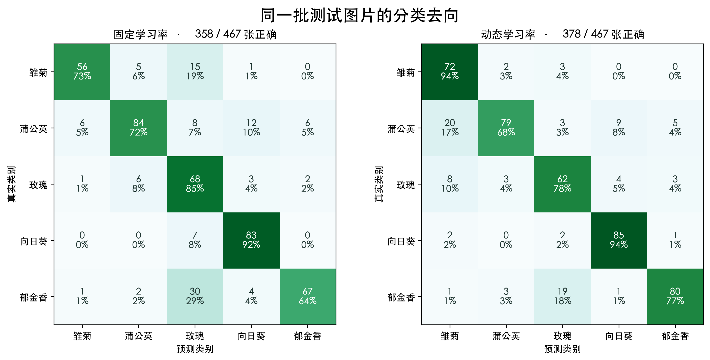

# AI 作业 2 · 五类花卉识别

用 PyTorch 从头训练一个四层卷积神经网络，识别雏菊、蒲公英、玫瑰、向日葵和郁金香。两组实验使用相同的网络、数据划分、随机种子和 25 轮训练预算，比较 Adam 固定学习率与根据验证损失动态调节学习率的效果。

[交互式 Notebook](花卉识别实验.ipynb) · [完整实验报告](实验报告/花卉识别实验报告.md) · [实验记录与图集](docs/实验记录.md) · [最终模型权重](runs/plateau/best.pt) · [图片署名与许可](实验报告/配图/IMAGE_CREDITS.txt)

## 实验结果

下表使用各组验证损失最低一轮的权重，在同一批 467 张测试图片上评估。

| 学习率策略 | 选用轮次 | 验证损失 | 测试正确数 | 测试准确率 | 宏平均 F1 |
|---|---:|---:|---:|---:|---:|
| 固定学习率 | 22 | 0.6578 | 358 / 467 | 76.66% | 0.7691 |
| 动态学习率 | 24 | 0.5655 | 378 / 467 | **80.94%** | **0.8081** |

动态学习率组在第 14、20 轮开始时分别将学习率降到 0.0005 和 0.00025，测试集净多认对 20 张，准确率提高 4.28 个百分点。上述差异来自同一数据划分和一个训练种子。逐轮指标及逐图预测见 [固定组记录](runs/formal/) 和 [动态组记录](runs/plateau/)。



## 安装与单图识别

在仓库根目录用 Python 3.13 创建环境并安装依赖。以下命令适用于 macOS 和 Linux。

```bash
python3.13 -m venv .venv
source .venv/bin/activate
python -m pip install -r requirements.txt
```

仓库包含训练好的权重。将图片路径换成自己的花卉照片，即可看到预测类别和五类概率。

```bash
python main.py predict --run-dir runs/plateau --image "/path/to/flower.jpg"
```

## 在 JupyterLab 逐格运行

[花卉识别实验.ipynb](花卉识别实验.ipynb) 保存了已执行的输出，可以在 GitHub 直接预览。若要交互运行，先按上一节安装实验依赖，再从仓库根目录启动 JupyterLab。

```bash
python -m pip install jupyterlab ipykernel
python -m jupyterlab
```

打开 Notebook，选择与项目依赖相同的 Python 内核，按 **Shift + Enter** 逐格运行。查看已有曲线和指标可直接运行；重新评估需要在第 1 节配置课程数据目录。想预测自己的照片，可以设置 `IMAGE_PATH`。最后一格默认跳过正式训练，将 `RUN_TRAINING` 设为 `True` 可在单独的目录中从头训练。

## 数据与实验复现

完整课程数据集需自行放到本地 `flower_data/`，其中 `train/` 和 `val/` 各含 `daisy`、`dandelion`、`roses`、`sunflowers`、`tulips` 五个类别目录。数据清理后划分为 2,650 张训练图、545 张验证图和 467 张测试图。已保存的清单使用相对路径。

```bash
# 重新评估最终模型
python main.py evaluate --run-dir runs/plateau

# 从随机初始化复现动态学习率实验
python main.py prepare --run-dir runs/plateau_replay
python main.py train --run-dir runs/plateau_replay --lr-schedule plateau
python plot_training.py --run-dir runs/plateau_replay
python main.py evaluate --run-dir runs/plateau_replay
```

复现固定学习率组时使用另一个新目录，并将 `--lr-schedule` 设置为 `constant`。正式训练运行在 Apple MPS 上，程序会在 MPS 不可用时使用 CPU。不同设备和库版本可能产生细微数值差异。

使用仓库内已有的实验记录，可直接运行 `python compare_runs.py` 复核两组指标。重新生成带实图的结果图集需先准备课程数据，再运行 `python plot_results.py`。

## 项目结构

| 路径 | 用途 |
|---|---|
| [main.py](main.py) | 数据划分、训练、评估和单图预测的命令行入口 |
| [data.py](data.py) · [preprocess.py](preprocess.py) | 类别标签、图片读取与预处理 |
| [model.py](model.py) · [training.py](training.py) | CNN、训练循环、学习率调度和最佳权重保存 |
| [inference.py](inference.py) · [evaluation.py](evaluation.py) | 权重加载、单图识别、测试指标与逐图预测 |
| [runs/](runs/) | 两组实验的权重、日志、指标和结果图 |
| [实验报告/](实验报告/) | Markdown 报告及配图 |
