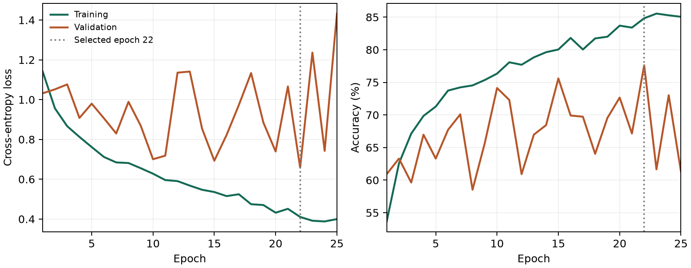
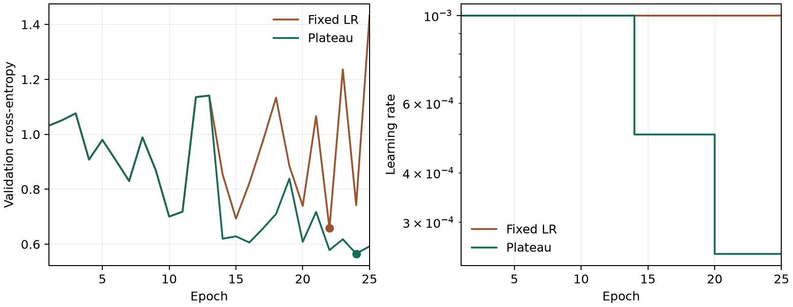
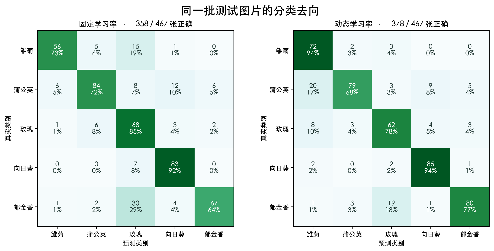
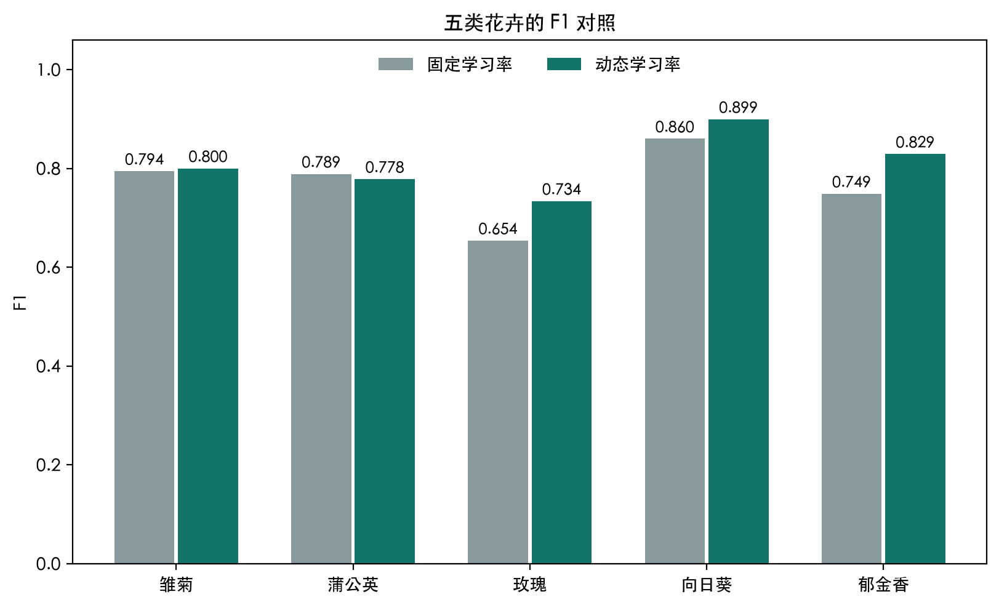
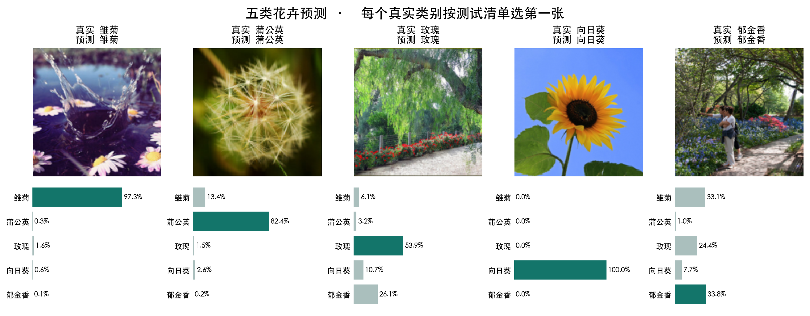
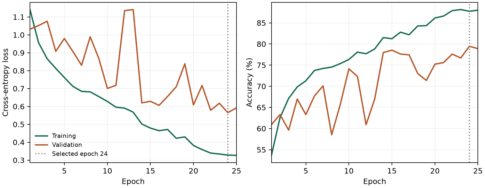

# 五类花卉识别实验记录

本实验使用课程提供的花卉照片，从随机初始化训练一个卷积神经网络（CNN），识别雏菊、蒲公英、玫瑰、向日葵和郁金香。固定学习率基线认对 358 / 467 张。借鉴优秀作业的学习率调度后，按验证损失选出的第 24 轮模型认对 **378 / 467 张**，准确率 **80.94%**，宏平均 F1 **0.8081**。前三部分记录基线实验，第四部分给出优化对照及新模型的调用方法。

本文按课件的「数据处理 → 模型构建 → 图像识别」整理九个小节。所有命令均在项目根目录 `flower`运行。当前环境为 Python 3.13.17、PyTorch 2.15.0、torchvision 0.29.2。先在终端运行下面的命令激活已有环境，随后即可使用各节中的 `python` 命令。

```bash
source .venv/bin/activate
```

原始图片位于 `flower_data/`。基线实验的清单、日志、权重和预测均保存在 `runs/formal/`。下文需要重新划分或训练的命令使用独立的 `runs/replay/` 目录，便于把自己的运行记录与本文对照。

## 一、数据处理

### 1.1 数据读取

一张照片的路径同时告诉我们它的来源和标签。例如，`train/daisy/100080576_f52e8ee070_n.jpg` 来自原训练集，父目录 `daisy` 对应雏菊。程序固定五类的顺序，在遍历目录时将每张图片记为「路径、整数标签」。训练和推理共用这一顺序，模型输出的第 0 列始终对应雏菊。运行 `python data.py` 可查看各类数量，并读取第一张原图的尺寸和颜色模式。[读取代码](../data.py)

| 编号 | 类别 | 目录 | 原训练集 | 原验证集 |
|---:|---|---|---:|---:|
| 0 | 雏菊 | daisy | 515 | 117 |
| 1 | 蒲公英 | dandelion | 776 | 121 |
| 2 | 玫瑰 | roses | 536 | 104 |
| 3 | 向日葵 | sunflowers | 601 | 97 |
| 4 | 郁金香 | tulips | 691 | 108 |
| | **合计** | | **3,119** | **547** |

### 1.2 数据集划分

先按文件内容计算 SHA-256。原训练集中有两对完全相同的向日葵照片，每对保留路径排序靠前的一张。原验证集中有一张照片同时标为玫瑰和郁金香，两份均排除。3,666 张原图中共有 3,662 张进入清单，三个集合间的文件哈希交集为空。[划分代码](../main.py) · [排除明细](../runs/formal/excluded.csv)

保留清理后的原验证集，从原训练集按类别分别抽取约 15% 作为测试集。类别内先按路径排序，固定种子 2026，进行无放回抽样。例如，515 张雏菊取出 77 张测试，留下 438 张训练。清单中的 `source_split` 表示原目录，`split` 才是本次用途；后面按这一列加载图片。[正式划分清单](../runs/formal/manifest.csv)

| 类别 | 训练 | 验证 | 测试 |
|---|---:|---:|---:|
| 雏菊 | 438 | 117 | 77 |
| 蒲公英 | 660 | 121 | 116 |
| 玫瑰 | 456 | 103 | 80 |
| 向日葵 | 509 | 97 | 90 |
| 郁金香 | 587 | 107 | 104 |
| **合计** | **2,650** | **545** | **467** |

```bash
python main.py prepare --run-dir runs/replay
```

### 1.3 图像预处理

以第 1.1 节的雏菊为例，`load_image()` 按拍摄方向校正图像，转为 RGB，将短边缩至 128，再居中裁剪。原图从 **320×263** 等比例缩至 **155×128**，裁成 **128×128**。等比例缩放保留了花朵的宽高比，裁剪则可能截去边缘的花瓣。随后把通道移到最前面，并将像素除以 255。例如裁剪后左上角的 RGB 值由 `(163,164,168)` 变为约 `(0.639,0.643,0.659)`。训练、验证、测试和单图推理使用同一套变换。[预处理与 FlowerDataset](../preprocess.py)

运行 `python preprocess.py` 可逐步查看尺寸。一张图的形状为 `[3,128,128]`，32 张组成一个批次时，图片与标签的形状分别为 `[32,3,128,128]` 和 `[32]`。

## 二、模型构建

### 2.1 模型定义

每个卷积块依次进行 3×3 卷积、BatchNorm、ReLU 和 2×2 最大池化。卷积提取局部特征，池化将宽和高各减半。下表省略批次维度。运行 `python model.py` 可用真实图片查看各层输出。[FlowerCNN 定义](../model.py)

| 阶段 | 单张图片的输出 |
|---|---|
| RGB 输入 | 3 × 128 × 128 |
| 卷积块 1、2 | 32 × 64 × 64 → 64 × 32 × 32 |
| 卷积块 3、4 | 128 × 16 × 16 → 256 × 8 × 8 |
| 全局平均池化并展平 | 每个通道的 64 个值取平均，得到 256 个特征 |
| Dropout（0.2）、线性分类层 | 五个类别分数（logits） |

模型共有 **390,181 个可训练参数**。训练时将 logits 直接传入交叉熵损失函数；展示预测时再用 Softmax 转为五类概率。

### 2.2 模型训练

每个训练批次依次执行清除梯度、前向计算、计算交叉熵、反向传播、Adam 更新。每轮结束后在验证集计算损失和准确率。训练开始前用 8 张图片检查了一次更新，分类层权重的最大变化约为 0.001，保存并重新加载后同一张图片的五个输出一致。随后重设种子 2026，从随机初始化正式训练。[训练代码](../training.py) · [小批量检查](../runs/formal/smoke.json)

正式设置为 Adam、学习率 0.001、批量 32、固定 25 轮。本机使用 Apple MPS，逐轮耗时合计约 100 秒。重新训练前先执行 1.2 的清单生成命令，再运行下列命令。每次重新训练应选择一个新的运行目录。[训练配置](../runs/formal/config.json) · [完整逐轮日志](../runs/formal/history.csv)

```bash
python main.py train --run-dir runs/replay
python plot_training.py --run-dir runs/replay
```

| 轮次 | 训练损失 | 训练准确率 | 验证损失 | 验证准确率 |
|---:|---:|---:|---:|---:|
| 1 | 1.1415 | 53.66% | 1.0319 | 60.92% |
| **22** | **0.4105** | **84.83%** | **0.6578** | **77.61%** |
| 25 | 0.3996 | 85.06% | 1.4323 | 61.28% |



最后三轮仍保持较高的训练准确率，验证损失却超过第 22 轮。按事先确定的最低验证损失规则，选用第 22 轮权重。

### 2.3 模型部署

本实验采用本地命令行推理。新进程先创建相同结构的 FlowerCNN，再加载权重并调用 `eval()`，使 Dropout 停用、BatchNorm 使用训练阶段记录的统计量。单图输入通过 `unsqueeze(0)` 增加批次维度，输出由 `[1,5]` 转为五类概率。下面的训练集样例用于检验调用流程，实测预测为雏菊（53.30%），其次为蒲公英（28.97%）。[推理代码](../inference.py)

```bash
python main.py predict --image flower_data/train/daisy/100080576_f52e8ee070_n.jpg
```

### 2.4 模型保存

权重保存发生在训练循环中。每当验证损失刷新最低值，程序先写临时文件，写完后替换 `best.pt`。文件包含 `model_state`（网络参数及 BatchNorm 状态）、`epoch`、`val_loss`、`classes` 和划分清单摘要 `manifest_sha256`。其中分类层权重形状为 `[5,256]`，对应五个类别各自的 256 个特征权重。[基线权重](../runs/formal/best.pt)

可以在项目目录查看保存的轮次与验证损失：

```bash
python -c "import torch; c = torch.load('runs/formal/best.pt', map_location='cpu', weights_only=True); print(c['epoch'], c['val_loss'])"
```

重新加载该文件，在 CPU 上复算全部 545 张验证图，得到损失 **0.65785**、准确率 **77.61%**，与第 22 轮日志相符。

## 三、图像识别

### 3.1 准备识别模型

`prepare_evaluation()` 加载最佳权重，核对类别顺序和划分清单哈希，再通过 `FlowerDataset("test")` 读取测试行。推理按清单顺序进行，便于逐图对应原路径。467 张图片组成 14 个完整批次和最后一个 19 张的小批次。运行 `python evaluation.py` 可检查首批输入 `[32,3,128,128]`、输出 `[32,5]` 以及每行五类概率之和。[评估准备与批次检查](../evaluation.py)

### 3.2 模型应用

运行 `python main.py evaluate` 可用基线权重重新评估全部测试图片。对每张图取五类概率最大的类别，与真实标签比较，并记录相对路径、真实类别、预测类别和五类概率。若要评估自己在 2.2 节重新训练的模型，可追加 `--run-dir runs/replay`。[逐图预测](../runs/formal/test_predictions.csv) · [汇总指标](../runs/formal/test_metrics.json)

**混淆矩阵按行表示真实类别，按列表示预测类别。**

| 真实类别＼预测类别 | 雏菊 | 蒲公英 | 玫瑰 | 向日葵 | 郁金香 |
|---|---:|---:|---:|---:|---:|
| 雏菊 | **56** | 5 | 15 | 1 | 0 |
| 蒲公英 | 6 | **84** | 8 | 12 | 6 |
| 玫瑰 | 1 | 6 | **68** | 3 | 2 |
| 向日葵 | 0 | 0 | 7 | **83** | 0 |
| 郁金香 | 1 | 2 | 30 | 4 | **67** |

对角线合计 358，测试准确率为 **358 / 467 = 76.66%**。逐类计算 F1，再给五类相同权重求平均，得到 **0.7691**。向日葵有 83 / 90 张识别正确。最常见的错判是郁金香被判为玫瑰（30 张），反向只有 2 张。玫瑰一列共有 128 张预测，其中 68 张确实是玫瑰，解释了该类精确率只有 53.13%。

例如，真实为雏菊的 `10466290366_cc72e33532.jpg` 得到的五类概率依次为 9.07%、50.66%、17.73%、5.87%、16.67%。最大值对应蒲公英，因此它计入矩阵第一行、第二列。逐图结果已独立复算，混淆矩阵共覆盖 467 张，准确率和宏平均 F1 与汇总文件一致。上述结论适用于这次固定划分及五个课程类别。

**提交约定**：按课件要求，提交报告时排除原始数据集 `flower_data/`。项目中的清单以相对路径引用课程图片。

## 四、优化实验：验证损失停滞时降低学习率

侯琬琪的《花卉识别》实验报告第 4 页采用 ReduceLROnPlateau，第 5–6 页展示的测试结果为每类 1 张、共 5 张全部正确。我们的固定学习率基线在第 22 至 25 轮训练损失从 0.4105 降至 0.3996，验证损失却从 0.6578 升至 1.4323。因此本次选取学习率调度作为唯一实验变量，检验减小训练后期的更新步幅能否改善验证表现。

两组使用同一份逐图清单、随机种子 2026、CNN、图像预处理、Adam、批量 32 和 25 轮训练预算，均从随机初始化训练，按最低验证损失选权重。优化组初始学习率为 0.001，验证损失连续三轮未达到调度器的改善阈值时将学习率减半（patience=2），下限为 0.00001。实际在第 14、20 轮开始时分别降至 0.0005、0.00025。[逐轮学习率及指标](../runs/plateau/history.csv)

| 实验 | 最佳轮次 | 验证损失 | 该轮验证准确率 | 测试正确数 | 测试准确率 | 宏平均 F1 |
|---|---:|---:|---:|---:|---:|---:|
| 固定学习率 | 22 | 0.6578 | 77.61% | 358 / 467 | 76.66% | 0.7691 |
| 动态学习率 | 24 | 0.5655 | 79.45% | 378 / 467 | 80.94% | 0.8081 |



按同一图片配对，优化组纠正了 40 个原有错误，同时新增 20 个错误，净多认对 20 张。郁金香被判成玫瑰从 30 张降到 19 张，郁金香 F1 从 0.7486 升至 0.8290。蒲公英被判成雏菊从 6 张增至 20 张，蒲公英 F1 从 0.7887 降到 0.7783。上述差异来自同一划分和一个随机种子；测试集在基线阶段已经查看，新的外部样本或多种子实验可进一步检验结果。[优化权重](../runs/plateau/best.pt) · [分类指标和混淆矩阵](../runs/plateau/test_metrics.json) · [逐图预测](../runs/plateau/test_predictions.csv)

使用优化模型及复核对照：

```bash
python main.py predict --run-dir runs/plateau --image flower_data/train/daisy/100080576_f52e8ee070_n.jpg
python main.py evaluate --run-dir runs/plateau
python compare_runs.py
```

从头复现优化组时使用新目录：

```bash
python main.py prepare --run-dir runs/plateau_replay
python main.py train --run-dir runs/plateau_replay --lr-schedule plateau
python main.py evaluate --run-dir runs/plateau_replay
```

## 五、实验结果图集

### 同一测试集上的分类结果

两张矩阵共用颜色尺度。每格上方是图片张数，下方是该张数占真实类别的比例。动态学习率组把郁金香误判为玫瑰的数量从 30 张降到 19 张，同时把蒲公英误判为雏菊的数量从 6 张增到 20 张。



### 各类别的 F1

玫瑰和郁金香的 F1 均提高约 0.08；蒲公英从 0.789 降到 0.778。两种学习率策略都在向日葵上取得五类中最高的 F1。



### 五类测试图与完整预测概率

每类按测试清单顺序取第一张，显示模型实际接收的中心裁剪区域。绿色为预测类别，灰色为其余类别。郁金香示例中，模型给郁金香和雏菊的概率分别约为 33.8% 和 33.1%，尽管分类正确，两类分数非常接近。



### 典型错判

按错判方向的出现次数排序，取前六种，再从每种方向选取预测概率最高的一张。每幅图上方同时标注该方向的总错判数与这张图的预测概率。例如，左上角的蒲公英被错判为雏菊，模型赋给雏菊的概率达 99.5%。这些样例专门展示高置信度错误，不能用来估算全部错例的平均置信度。


### 优化模型的训练过程

左图为每轮交叉熵损失，右图为准确率，竖线标出以验证损失选中的第 24 轮。第四部分另有两种训练策略的逐轮验证损失和学习率对照。



运行 `python plot_results.py` 可从两组正式实验记录重新生成四张测试结果图。绘图前会复核逐图预测和指标，实图使用课程数据集的照片；作者、原图链接及 CC BY 2.0 许可见[样例图片署名](../runs/plateau/figures/IMAGE_CREDITS.txt)。
