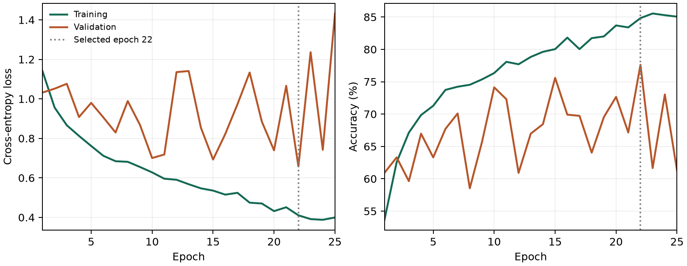
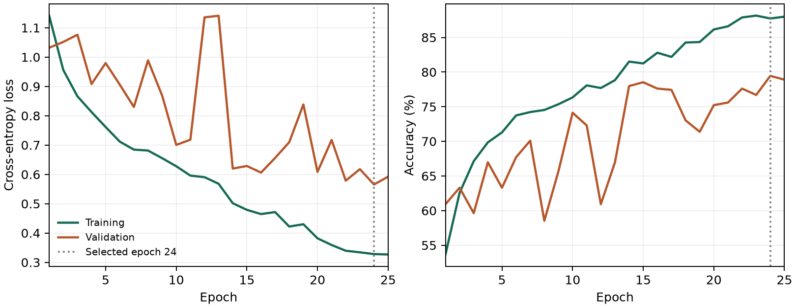
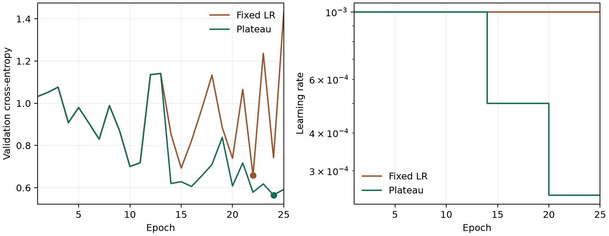
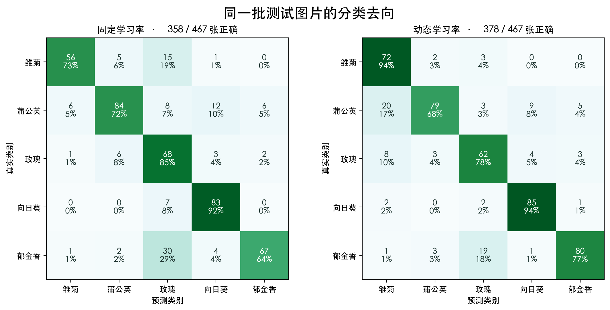
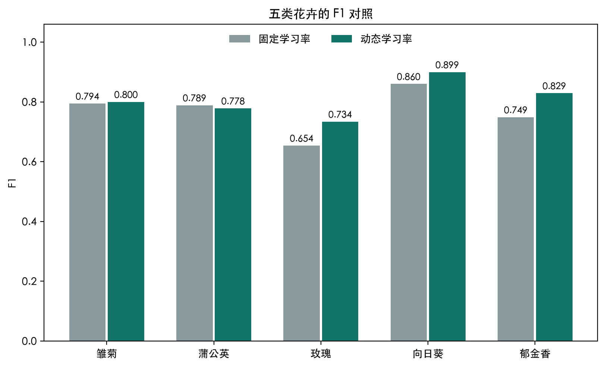
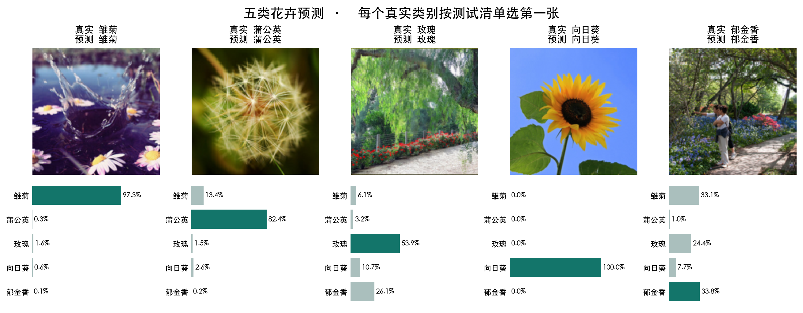

# 五类花卉图像识别实验报告

**课程**　人工智能原理　　**实验主题**　从头训练卷积神经网络，比较两种学习率策略

## 一、实验目的与结果概述

给定一张花卉照片，本实验要从雏菊、蒲公英、玫瑰、向日葵和郁金香中预测一个类别，并给出五类概率。实验关注一个具体问题：使用相同的卷积神经网络时，在验证损失停滞后减小学习率，能否改善识别效果？

两组实验各从随机权重开始训练 25 轮。固定学习率组在 467 张测试图上认对 358 张；动态学习率组认对 378 张，准确率由 **76.66% 升至 80.94%**。逐图比较发现，动态学习率组纠正了原有的 40 个错误，同时新增了 20 个错误。后文结合训练曲线和具体花卉分析这两类变化。

## 二、数据处理

### 2.1 图片读取与数据划分

课程原始数据按类别存放在训练和验证目录中。程序从父目录读取标签，将五类花依次编码为 0 至 4。对全部 3,666 张图片计算文件内容的 SHA-256 后，发现训练集中有两对完全相同的向日葵照片，每对保留一份；验证集中同一张照片分别标为玫瑰和郁金香，两份均排除。最终保留 3,662 张。

保留课程原验证集的用途，从清理后的原训练集中按类别抽取约 15% 作为测试集，随机种子为 2026。每张图片的最终用途写入清单，三个集合之间没有相同的文件内容哈希。

| 类别 | 原训练集 | 原验证集 | 最终训练集 | 最终验证集 | 最终测试集 |
|---|---:|---:|---:|---:|---:|
| 雏菊 | 515 | 117 | 438 | 117 | 77 |
| 蒲公英 | 776 | 121 | 660 | 121 | 116 |
| 玫瑰 | 536 | 104 | 456 | 103 | 80 |
| 向日葵 | 601 | 97 | 509 | 97 | 90 |
| 郁金香 | 691 | 108 | 587 | 107 | 104 |
| **合计** | **3,119** | **547** | **2,650** | **545** | **467** |

### 2.2 图像预处理

训练、验证和推理使用同一套预处理。先按拍摄方向校正照片并转为 RGB，将短边等比例缩至 128 像素，再从中心裁出 128 × 128 的方形区域，将像素除以 255。例如，一张 320 × 263 的雏菊照片先缩至 155 × 128，再裁至 128 × 128，最终张量形状为 `[3, 128, 128]`。这一处理保留了主体的宽高比例，但位于边缘的花瓣可能在裁剪中丢失。图 6 和图 7 展示的就是模型实际看到的裁剪区域。

### 2.3 从数据清单构造训练批次

读取数据时需要区分图片的存放位置和实验用途。例如，一张雏菊照片即使位于原始的 `train/daisy/` 目录，也可能已被抽为测试样本。`FlowerDataset` 按清单中的 `split` 字段选样本，并返回图像张量和整数标签。这样从训练切换到测试时可以复用同一套读取方法，也能按路径追溯图 7 中的错误来自哪张原图。

训练集每轮打乱样本顺序。一个完整批次的输入形状为 `[32, 3, 128, 128]`，标签形状为 `[32]`。验证和测试按清单顺序读取，以便将每行输出对应回原图。467 张测试图片组成 14 个完整批次和最后 19 张图片，全部计入评估。

## 三、模型架构与代码分析

### 3.1 整体结构与参数统计

本实验通过 PyTorch 的 `nn.Module` 定义 `FlowerCNN`，使用 `nn.Sequential` 顺序组织四个卷积块。输入是一批 RGB 图像，形状为 `[N, 3, 128, 128]`，其中 N 为批次大小。网络依次完成局部特征提取、空间尺寸压缩、全局特征汇总和五类分类。两组实验共用这一结构，均从随机初始化开始学习。

| 阶段 | 主要操作 | 单张图片的输出 | 可训练参数 |
|---|---|---|---:|
| 输入层 | 128 × 128 的 RGB 图像 | 3 × 128 × 128 | 0 |
| 卷积块 1 | 3 × 3 卷积，3 → 32 通道，BN，ReLU，池化 | 32 × 64 × 64 | 928 |
| 卷积块 2 | 3 × 3 卷积，32 → 64 通道，BN，ReLU，池化 | 64 × 32 × 32 | 18,560 |
| 卷积块 3 | 3 × 3 卷积，64 → 128 通道，BN，ReLU，池化 | 128 × 16 × 16 | 73,984 |
| 卷积块 4 | 3 × 3 卷积，128 → 256 通道，BN，ReLU，池化 | 256 × 8 × 8 | 295,424 |
| 全局平均池化 | 对每个通道的 8 × 8 特征图取平均 | 256 × 1 × 1 | 0 |
| 展平与 Dropout | 展平通道特征，丢弃概率为 0.2 | 256 个特征 | 0 |
| 线性输出层 | 将 256 个特征映射到五类分数 | 5 个 logits | 1,285 |
| **合计** | | | **390,181** |

参数量由实际代码统计。卷积块 1 的卷积核包含 `32 × 3 × 3 × 3 = 864` 个参数，BN 另有 32 个缩放系数和 32 个平移系数，共 928 个。最后的线性层具有 `256 × 5 + 5 = 1,285` 个参数，分别对应连接权重和偏置。BN 在训练中还记录运行均值、方差和批次计数，这些状态随模型保存，通过前向计算更新。

### 3.2 卷积块的实现与作用

四个卷积块采用统一结构，只调整输入与输出通道数。`model.py` 中的实现如下。

```python
def conv_block(in_channels, out_channels):
    return nn.Sequential(
        nn.Conv2d(in_channels, out_channels, kernel_size=3, padding=1, bias=False),
        nn.BatchNorm2d(out_channels),
        nn.ReLU(),
        nn.MaxPool2d(kernel_size=2),
    )
```

**卷积层。** `kernel_size=3` 表示每次计算覆盖一个 3 × 3 的局部区域，默认步长为 1，`padding=1` 在边缘补一圈零，使卷积前后的宽高相同。一个卷积核同时读取所有输入通道，生成一张输出特征图。不同卷积核可以学习不同的局部响应，逐层组合后用于区分花瓣纹理、颜色分布及形状。卷积权重在各位置共享，因此同一个局部模式可以在图像不同区域被响应。

**批归一化与激活。** `BatchNorm2d` 在训练时按通道计算当前批次的均值和方差，再进行带可学习缩放和平移的归一化，并累计运行统计量。后接 BN 的卷积设置 `bias=False`，平移由 BN 的可学习参数承担。`ReLU` 将负值置零，为网络引入非线性，使多层组合能够学习更复杂的分类关系。

**最大池化。** `MaxPool2d(2)` 以默认步长 2 在每个 2 × 2 区域取最大值，将宽和高各缩小一半。四次池化后，空间尺寸从 128 × 128 依次变为 64 × 64、32 × 32、16 × 16 和 8 × 8。与此同时，通道数逐步增加到 256，网络用更多特征图表示经过空间压缩后的图像信息。

### 3.3 全局池化、分类头与前向传播

四个卷积块之后，每张图片产生 256 张 8 × 8 特征图。全局平均池化对每个通道的 64 个位置求均值，保留该通道的整体响应。分类头的初始化代码为 `FlowerCNN.__init__()` 中的以下四行。

```python
self.pool = nn.AdaptiveAvgPool2d(1)
self.flatten = nn.Flatten(start_dim=1)
self.dropout = nn.Dropout(p=0.2)
self.classifier = nn.Linear(256, len(CLASSES))
```

`AdaptiveAvgPool2d(1)` 将每个通道的空间尺寸变为 1 × 1。`Flatten(start_dim=1)` 保留第 0 维的批次结构，将每张图片的输出整理为 256 个特征，因此分类层的输入规模较小。训练时，Dropout 以 0.2 的概率随机将特征置零，并对保留值进行相应缩放，用于降低分类层对特定特征组合的依赖。评估模式下，Dropout 直接传递输入。

前向传播按定义好的顺序执行各层，完整计算路径集中在 `forward()` 中。

```python
def forward(self, images):
    features = self.features(images)
    pooled = self.flatten(self.pool(features))
    return self.classifier(self.dropout(pooled))
```

第一行得到形状为 `[N, 256, 8, 8]` 的特征，第二行汇总成 `[N, 256]`，最后输出 `[N, 5]`。五列依次对应雏菊、蒲公英、玫瑰、向日葵和郁金香。训练时交叉熵直接使用这些 logits，识别时再转换为图 6 中展示的五类概率。

### 3.4 损失函数、优化器与训练代码

实验采用交叉熵损失和 Adam 优化器。对于一张真实类别为 y 的图片，交叉熵等于模型赋给类别 y 的概率的负对数。正确类别获得的概率越高，损失越低。PyTorch 的 `CrossEntropyLoss` 接收原始类别分数与整数标签，并在内部完成稳定的对数概率计算。

| 设置项 | 本次取值 |
|---|---|
| 运行环境 | Python 3.13.17、PyTorch 2.15.0、torchvision 0.29.2 |
| 训练设备与计算精度 | Apple MPS、float32 |
| 损失函数 | `nn.CrossEntropyLoss()`，批次内取平均 |
| 优化器 | Adam，初始学习率 0.001，权重衰减为 0 |
| 批量大小与训练轮数 | 32、25 轮 |
| 初始化与样本顺序 | 随机种子 2026，训练集每轮打乱 |
| 验证方式 | 每轮评估全部 545 张验证图片 |
| 权重选择依据 | 最低验证损失 |

一次训练批次的核心代码摘自 `training.py`。`images` 和 `labels` 已被移到训练设备上。

```python
optimizer.zero_grad(set_to_none=True)
logits = model(images)
loss = criterion(logits, labels)
loss.backward()
optimizer.step()
```

`zero_grad()` 清除上一次更新的梯度，`model(images)` 执行前向计算，`criterion` 根据真实标签计算平均损失。`backward()` 沿计算图求出损失对各参数的梯度，Adam 则利用梯度的一阶、二阶矩估计调整参数。五步循环遍历完 2,650 张训练图片后，完成一轮训练。

`run_epoch()` 同时用于训练和验证，通过是否传入优化器控制行为。训练时调用 `model.train(True)`，启用梯度计算。验证时调用 `model.train(False)` 并关闭梯度，使用 BN 累计的统计量，停用 Dropout。每轮损失按各批实际样本数加权求平均，使最后一个较小批次得到合适的权重。训练准确率是在模型逐批更新且启用 Dropout 的过程中累计的，验证准确率则对应该轮结束时的固定权重。

正式训练前，程序用 8 张图完成一次小批量检查。一次更新后分类层权重最大变化约为 0.001，保存与重新加载后同一张图的五个输出一致。随后重设种子并重新初始化网络，开始两组正式实验。

### 3.5 学习率调度与最佳权重保存

学习率对照借鉴了优秀报告中使用 `ReduceLROnPlateau` 的做法。本实验将学习率策略作为单一变量，两组共用网络、预处理、数据清单、随机种子和 25 轮训练预算。动态组根据验证损失决定何时减小后续更新的步幅。

| 训练组 | 学习率设置 | 实际变化 |
|---|---|---|
| 固定学习率组 | Adam 初始学习率 0.001 | 全程保持 0.001 |
| 动态学习率组 | ReduceLROnPlateau，衰减系数 0.5，patience 为 2，下限 0.00001 | 第 14 轮降至 0.0005，第 20 轮降至 0.00025 |

程序通过配置创建调度器，在每轮验证结束后调用 `scheduler.step(val_loss)`。当连续三个验证点未达到调度器的改善阈值时，下一轮学习率减半。最佳权重的保存另外比较实际验证损失，只有出现更小值时才更新文件。下面是实际保存分支，初始 `best` 为正无穷。

```python
if val_loss < best:
    checkpoint = dict(model_state=model.state_dict(), epoch=epoch, val_loss=val_loss,
                      classes=list(CLASSES), manifest_sha256=config["manifest_sha256"])
    temporary = run_dir / "best.pt.tmp"
    torch.save(checkpoint, temporary)
    temporary.replace(run_dir / "best.pt")
    best = val_loss
```

`model_state` 保存卷积、分类层参数与 BN 状态，`epoch` 和 `val_loss` 记录选择依据，`classes` 确保输出列与类别名称对应，`manifest_sha256` 用于核对评估数据清单。先写临时文件再替换正式文件，可使更新完成前已有的最佳权重保持完整。固定组最终选中第 22 轮，动态组选中第 24 轮，图中的 *Selected epoch* 标示这两个位置。

两组各完成 25 轮训练，共 50 轮。按逐轮日志合计，固定组耗时 100.41 秒，动态组耗时 100.34 秒，总计约 3 分 20.74 秒，统计范围包括训练、逐轮验证和最佳权重保存。

### 3.6 训练曲线与调度效果



**图 1　固定学习率组的损失与准确率。** 第 22 轮验证损失达到最低值 0.6578。到第 25 轮，训练损失从 0.4105 降至 0.3996，验证损失却升至 1.4323，验证准确率也从 77.61% 降至 61.28%。因此，选哪一轮对最终结果有实际影响。竖虚线标出保存权重的轮次。



**图 2　动态学习率组的损失与准确率。** 第 24 轮取得最低验证损失 0.5655，该轮验证准确率为 79.45%。第 25 轮验证损失回升到 0.5921，之后的测试采用第 24 轮权重。图 1、图 2 中的 *Selected epoch* 均按同一规则确定。



**图 3　降低学习率的时点及其对应的验证表现。** 右图标出了两次调低学习率的时点。与左图对照可见，两组在初期表现接近；第 14 轮首次减小步幅后，动态组验证损失降到约 0.62。后续仍有起伏，但第 24 轮取得了两组中最低的验证损失。

从训练日志可定位第一次调度的原因。动态组第 10 轮验证损失为 0.7005，第 11 至 13 轮分别为 0.7184、1.1355 和 1.1410，连续三个验证点都未改善。于是第 14 轮采用 0.0005 的学习率，验证损失下降到 0.6198。这里的两项决策相互独立：调度器改变下一轮训练的步幅，保存逻辑则记录迄今验证损失最低的权重。即使学习率已降低，后续每轮仍要重新验证。

## 四、图像识别与测试结果

### 4.1 模型加载、预测代码与整体评估

识别阶段由 `inference.py` 读取最佳权重文件，并检查保存的类别顺序。加载时在 CPU 上创建相同结构的 `FlowerCNN`，通过 `load_state_dict()` 恢复参数，再调用 `eval()` 切换至评估模式。实际恢复模型的代码如下。

```python
model = FlowerCNN()
model.load_state_dict(checkpoint["model_state"])
model.eval()
```

单图推理复用训练时的预处理。`unsqueeze(0)` 增加批次维度，将 `[3, 128, 128]` 转为 `[1, 3, 128, 128]`。输出沿类别维度做 Softmax，得到一组和为 1 的概率，随后按固定类别顺序组织结果。

```python
@torch.inference_mode()
def predict(model, image_path):
    batch = load_image(image_path).unsqueeze(0)
    logits = model(batch)
    probabilities = logits.softmax(dim=1)[0]
    return dict(zip(CLASSES, probabilities.tolist()))
```

`torch.inference_mode()` 关闭推理所需之外的梯度跟踪开销，`softmax(dim=1)` 对每张图片的五个分数进行归一化。最终预测取概率最大项对应的类别。完整测试按清单顺序遍历全部 467 张图片，保存每张图的路径、真实类别、预测类别和五类概率，最后由逐图记录计算汇总指标。

| 实验 | 选用轮次 | 验证损失 | 该轮验证准确率 | 测试正确数 | 测试准确率 | 宏平均 F1 |
|---|---:|---:|---:|---:|---:|---:|
| 固定学习率 | 22 | 0.6578 | 77.61% | 358 / 467 | 76.66% | 0.7691 |
| 动态学习率 | 24 | 0.5655 | 79.45% | 378 / 467 | **80.94%** | **0.8081** |

动态组测试准确率提高 **4.28 个百分点**，宏平均 F1 提高 **0.0390**。前者对每张图片等权，后者先计算每个类别的 F1，再对五类等权平均。两者同时上升，仍然可能有个别类别退步，具体见图 4、图 5。

### 4.2 混淆矩阵与逐类性能分析



**图 4　467 张测试图的混淆矩阵。** 行表示真实类别，列表示预测类别；每格上方是张数，下方是占该真实类别的比例。动态组把郁金香错判成玫瑰的数量从 30 张降到 19 张，把雏菊错判成玫瑰的数量从 15 张降到 3 张。与此同时，蒲公英错判成雏菊从 6 张增至 20 张，成为优化后最常见的错误方向。



**图 5　各类别的 F1。** 玫瑰和郁金香的 F1 分别从 0.654、0.749 提高到 0.734、0.829。玫瑰的变化尤其值得注意：正确识别的真实玫瑰从 68 张降至 62 张，但所有被判成玫瑰的照片也从 128 张降至 89 张。误报减少使精确率明显提高，综合精确率与召回率的 F1 最终上升。蒲公英 F1 则从 0.789 下降到 0.778。

**动态学习率组的逐类评估。** 精确率表示“判成这一类的图片中有多少判对”，召回率表示“这一类的真实图片中找回了多少”。两者的调和平均值为 F1。

| 类别 | 测试图片 | 正确识别 | 精确率 | 召回率 | F1 |
|---|---:|---:|---:|---:|---:|
| 雏菊 | 77 | 72 | 69.90% | 93.51% | 0.8000 |
| 蒲公英 | 116 | 79 | 90.80% | 68.10% | 0.7783 |
| 玫瑰 | 80 | 62 | 69.66% | 77.50% | 0.7337 |
| 向日葵 | 90 | 85 | 85.86% | 94.44% | 0.8995 |
| 郁金香 | 104 | 80 | 89.89% | 76.92% | 0.8290 |

雏菊与蒲公英呈现了两种不同的错误分布。77 张真实雏菊中找回了 72 张，召回率较高；但在所有判为雏菊的 103 张图片中混入了 31 张其他类别，精确率为 69.90%。蒲公英则相反，模型给出的 87 个蒲公英预测有 79 个正确，但 116 张真实蒲公英中有 37 张被判为其他类别。由此可以看出，提高这两类的识别效果需要重点检查哪些样本被判成了雏菊。

### 4.3 实图预测与典型错误



**图 6　五类花卉的单图预测。** 每类固定取测试清单中的第一张，上排显示模型输入，下排给出五类概率。向日葵示例的分数高度集中；郁金香示例虽然认对，郁金香与雏菊的概率却分别只有约 33.8% 和 33.1%。同样是一次正确预测，这两个样例的第一、第二候选之间有很不同的差距。


**图 7　动态学习率组的典型错例。** 按错判次数取前六种方向，再从每个方向选择预测概率最高的一张。左上角的蒲公英种球被判成雏菊，预测概率达到 99.5%；上排中间的郁金香被判成玫瑰，预测概率约 98.7%。图中有花瓣特写、远景花丛和图案化花朵，主体尺度和背景差异为后续错误分析提供了线索。样例按高置信度刻意选取，因此不能据此推断所有错例的平均置信度。

**同一张图片在两种策略下的变化。** 图 6 最右侧是测试清单中第一张郁金香。固定学习率组给玫瑰 52.69%、郁金香 33.25%，将其错判为玫瑰。动态组给郁金香 33.77%、雏菊 33.09%、玫瑰 24.45%，最终认对。这次纠错主要体现为候选类别的排序变化，郁金香自身的概率只提高了约半个百分点。与图 7 中高概率的错判结合来看，单图解释应同时查看真实标签、最高分以及与次高分的差距。

## 五、实验总结与改进方向

本实验完成了数据审计与划分、CNN 构建、从头训练、最佳权重保存以及五类花卉识别。固定网络和训练预算后，动态学习率使最低验证损失从 0.6578 降至 0.5655，并在同一批 467 张测试图上净多认对 20 张，最终准确率为 80.94%，宏平均 F1 为 0.8081。这一结果说明，当前网络的表现除了受结构影响，也与训练过程中的参数更新步幅有关。

从类别结果看，玫瑰误报减少，郁金香识别改善，同时更多蒲公英被判成雏菊。图 7 的错误样例提示，花朵形态、主体尺度和复杂背景可能影响判别，仍需通过进一步实验确认这些因素各自的作用。分类概率高度集中也可能对应错误预测，解释识别结果时需要结合真实标签和图像内容。

本次对照只采用一个固定种子，测试图与训练图来自同一课程数据源，且基线阶段已查看过测试集表现。后续可以更换多个训练种子，统计两组指标的均值与波动，再使用独立采集的外部照片检验效果。对于蒲公英，可按花期和种球期分别计算召回率。对于主体靠边的图片，可在相同预算下比较中心裁剪与等比例缩放后填充，检验预处理方式对错判的影响。
